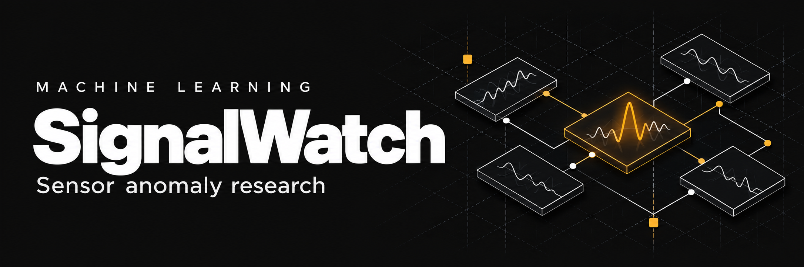
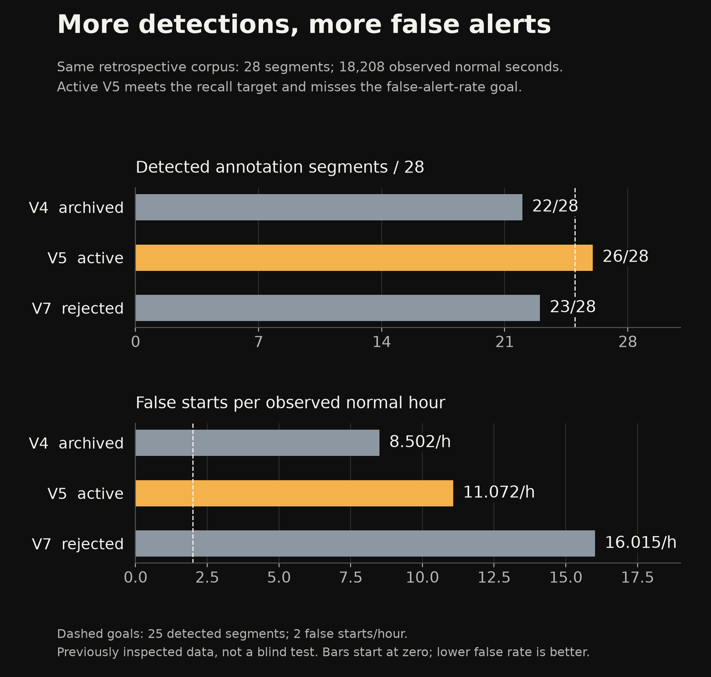
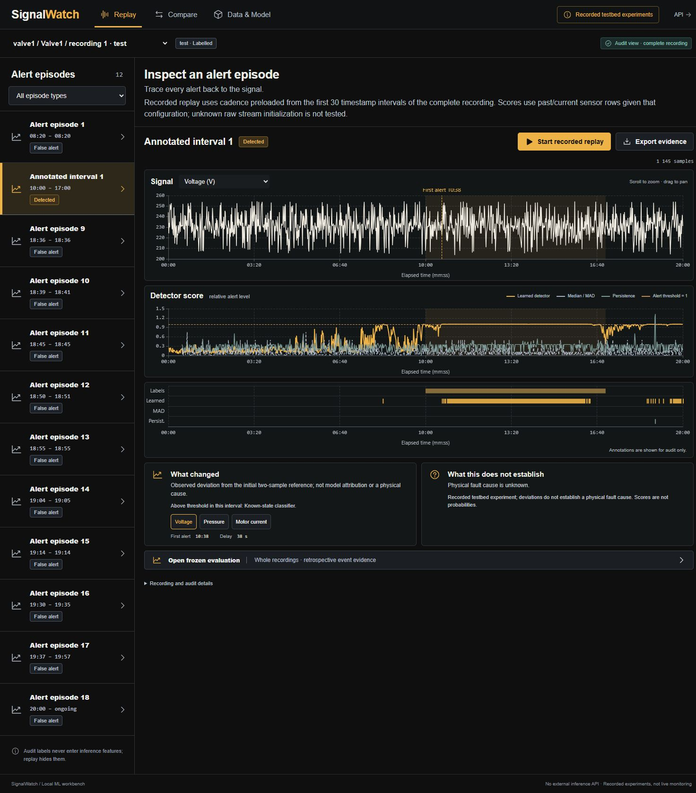
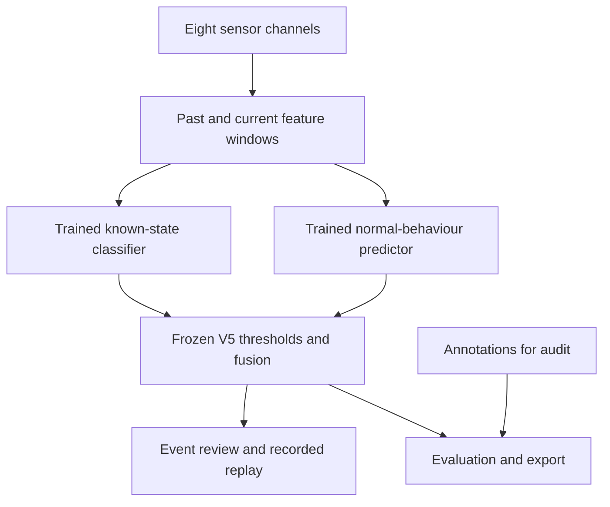

# SignalWatch

A local ML workbench for understanding sensor anomalies, false alerts and detection delay.

[Results and limits](docs/RESULTS.md) · [V1-V13 history](docs/RESEARCH_LOG.md) · [Run locally](#run-locally) · [API contract](docs/API_CONTRACT.md) · [Screenshots](docs/SCREENSHOTS.md)

> **Research snapshot: 27 October 2026.** New training and cutoff searches are paused. V5 remains the active model artifact; V13 is the latest research experiment. False-alert control remains unresolved.

SignalWatch uses recorded water-circulation testbed data from SKAB. It compares trained machine learning with rolling median/MAD and persistence baselines, then lets you inspect the actual traces behind detections, misses and false alerts. A high model score does not establish a physical fault cause or a field-failure probability.

## What we measured

| V5 evidence | Events detected | False starts | False starts / normal hour | Normal time in alert |
|---|---:|---:|---:|---:|
| Grouped OOF development | 28/29 | 3 | 1.177 | 37/9,179 s = 0.403% |
| Retrospective audit | **26/28** | **56** | **11.072** | 272/18,208 s = 1.494% |

OOF means each development recording is scored by models fitted on other recordings. V5 meets the requested minimum of 25/28 events, but exceeds the 2/h false-start goal on the retrospective corpus. We had already inspected those recordings during V1. The audit is **retrospective, not a new blind test**, and repeated development reuse can overfit selection. Annotation segments are not independent physical failures.



[Full results, definitions and limits](docs/RESULTS.md) · [Full-precision CSV](docs/research/retrospective-results.csv) · [Model card](docs/MODEL_CARD.md) · [Data card](docs/DATA_CARD.md)

## Explore the workbench



- Replay a bundled recording, then inspect detected, missed and false-alert intervals. Replay hides future sensor rows and labels under a declared preloaded cadence configuration.
- Compare the trained detector with simple baselines and keep saved retrospective results separate from development threshold exploration.
- Import a CSV with explicit eight-sensor mapping, save a local session, inspect model/data provenance and export or delete local uploads.

The [screenshot guide](docs/SCREENSHOTS.md) explains desktop/mobile captures and their verification limits. The generated design concept remains an illustrative reference; these screenshots show actual local results.

## What the research found

We retain unsuccessful experiments alongside improvements. V6 confirmation loses short events; V7's calibrated ensemble reduces development false starts but regresses on the retrospective audit. V10-V12 change learned features/models without meeting the joint recall, gradual-event and false-alert requirements.

V13 corrects training-bank Pressure scaling. All numerical audits pass. With both gradual intervals and 27/29 total hits retained, K4 false starts fall 40 to 21, while linear-defect delay rises 3 to 46 seconds. K2 worsens 6 to 17; K1 stays at five. None of 306 predeclared operating points passes the full quality screen. We retain V5.

The [V1-V13 chronology](docs/RESEARCH_LOG.md) records changes, decisions and frozen evidence. The [latest paired result](docs/ML_V13_PRESSURE_SCALING_RESEARCH.md) and [three research figures](docs/research/README.md) expose the detection/burden/delay trade-offs. These are error-driven engineering iterations; automatic live feedback training and evolutionary mutation/crossover are not implemented.

## Application architecture

The React/TypeScript interface calls a local FastAPI backend. Active V5 combines a histogram gradient-boosted known-state classifier with an ExtraTrees normal-behaviour predictor: 120 classifier plus 32 predictor features. Both use current/past observations under preloaded cadence/gap settings. Local storage retains CSV uploads and replay sessions.



The V12/V13 mixture pipeline belongs to research artifacts and is not part of active V5 inference. [Implementation specification](docs/SPEC.md) and [API contract](docs/API_CONTRACT.md) describe the application.

## Run locally

Requirements: Python 3.11+, Node.js 22.12+ and npm. Use the locked Python dependencies and frontend/package-lock.json to reproduce the supplied artifact environment. The source was developed on Windows with Python 3.11 and Node.js 24.

Windows PowerShell, from the project root:

```powershell
python -m venv .venv
.\.venv\Scripts\python.exe -m pip install -r requirements.lock
.\.venv\Scripts\python.exe -m pip install --no-deps -e .
Set-Location frontend
npm ci
npm run build
Set-Location ..
.\.venv\Scripts\python.exe -m uvicorn signalwatch.api:app --host 127.0.0.1 --port 8772
```

macOS/Linux:

```bash
python3 -m venv .venv
.venv/bin/python -m pip install -r requirements.lock
.venv/bin/python -m pip install --no-deps -e .
cd frontend
npm ci
npm run build
cd ..
.venv/bin/python -m uvicorn signalwatch.api:app --host 127.0.0.1 --port 8772
```

Open [SignalWatch](http://127.0.0.1:8772/), [interactive API documentation](http://127.0.0.1:8772/docs) or the [OpenAPI schema](http://127.0.0.1:8772/openapi.json). The Python server serves the built frontend and the API from the same origin. GitHub Pages cannot run this backend. No public deployment is included.

The Swagger UI loads its standard assets from a CDN and needs internet access for that page. The application, bundled inference and JSON API run locally.

For frontend development, keep the API server running and run npm run dev in frontend/. Its Vite proxy forwards local API requests to port 8772.

## Inspect a recording

1. Select a bundled run. Its group and split identify the recorded experiment and its role in evaluation.
2. In audit view, select a detected, missed or false-alert episode. Review the signal, normalized detector scores, known annotations and each detector's alert intervals.
3. Start recorded replay to reveal sensor observations sequentially. Cadence/gap configuration is already loaded from the complete CSV; this does not test initialization from an unknown raw stream. Pause, step or restart. Labels stay hidden until you explicitly return to audit.
4. Open Compare for the saved retrospective report or a separately labelled grouped-OOF development budget experiment using saved operating points. Changing an exploratory budget does not rewrite the audit.
5. Open Data & Model for provenance, split/model information, local CSV import, saved sessions and repeatable training. Export contains actual trace/evaluation data and model provenance.

The reference image in docs/design/ is a user-approved visual concept. Its charts and numbers are illustrative and are not experiment results. The application uses saved model/data artifacts instead of those values.

## Local data and deletion

Uploaded CSV files and their column mappings are stored in runtime/uploads/ and runtime/sessions.sqlite3 on this machine. The application sends them to no external service. CSV import requires timestamp and the eight numeric sensor features expected by the trained model; map custom headers explicitly. Optional binary anomaly labels are used only for audit/evaluation. Without labels, detection-quality metrics remain unavailable. Non-finite values, invalid timestamps and oversized files are rejected with readable errors.

Deleting an upload removes its raw file, stored mapping, related replay sessions and cached results. Bundled recordings are not deleted through that control. Replay state persists across server restarts. A changed model requires restarting an older replay, so one session does not silently mix artifacts.

## Tests and optional retraining

Run the backend checks separately from release retraining:

```powershell
New-Item -ItemType Directory -Force work | Out-Null
.\.venv\Scripts\python.exe -m pytest --basetemp=work/pytest-final
```

**Retraining is optional and starts real ML fitting.** It is not needed to open the supplied application, inspect results or regenerate documentation. New research training is paused for this snapshot. The dataset preparation script fetches the pinned public SKAB snapshot and records hashes/notices. Training repeats the selected V5 hybrid study in an isolated work directory. It verifies the selected point and each audit recording's metrics/events before replacing active files. Repetition does not create independent evidence.

```powershell
.\.venv\Scripts\python.exe scripts/prepare_data.py
.\.venv\Scripts\python.exe scripts/train.py
```

On macOS/Linux use .venv/bin/python and mkdir -p work. The final report, model metadata and split manifest live under artifacts/. The learned model is a trusted local joblib artifact; do not replace it with untrusted downloaded or uploaded pickle/joblib content.

## Read and verify the research

| Start here | Contents |
|---|---|
| [Results and limits](docs/RESULTS.md) | Active result, retrospective comparison, latest Pressure study and unresolved goals |
| [Research history](docs/RESEARCH_LOG.md) | V1-V13 changes, negative findings and per-version methods |
| [Evaluation definitions](docs/ML_EVALUATION.md) | Actual onset credit, observed exposure, delay and warm-up |
| [Related work](docs/RELATED_WORK_COMPARISON.md) | Eight papers/five technical sources; implementation and access limits |
| [Figures and data](docs/research/README.md) | Three PNG/SVG pairs, CSV/JSON, source hashes and a no-training verification command |
| [Requirements](docs/REQUIREMENTS.md) / [Verification](docs/VERIFICATION.md) | Completed software checks, paused research and remaining quality gaps |
| [Resources](docs/RESOURCES.md) | Dataset, dependency and documentation provenance |

Check the supplied figure/data package without training or plotting dependencies:

```powershell
.\.venv\Scripts\python.exe scripts/build_research_summary.py --check
```

The last backend suite before V13 passed 192 tests with seven existing warnings. That is historical source verification, not a fresh full-suite run for this documentation snapshot. No field-equipment or new-machine validation is established. The separate four-intervention teaser check uses the same physical testbed and different background assumptions; it is not a replacement validation set.

SKAB resources retain their upstream notices/license terms. This snapshot does not select a license for the original SignalWatch application source; dependency licenses remain separate. The project runs with a Python server. GitHub can display these documents and images; it cannot execute this backend through GitHub Pages. No public hosted demo is included.
