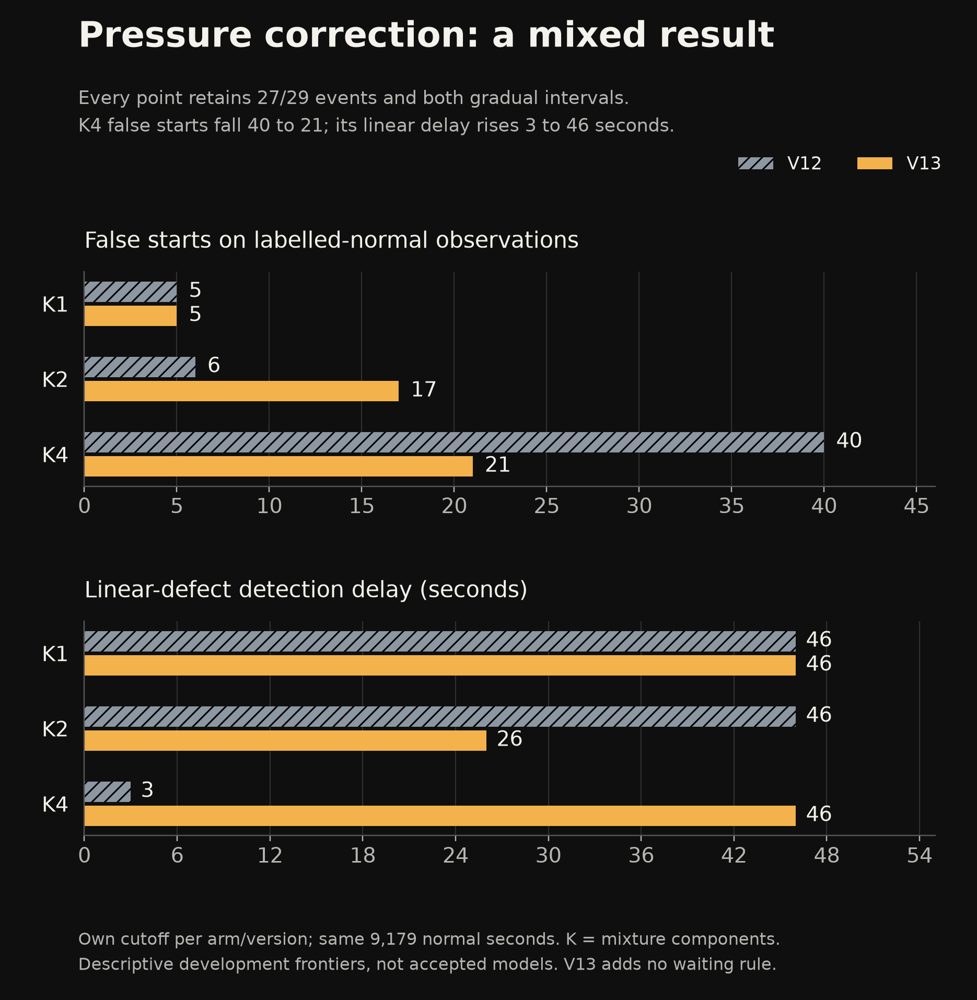
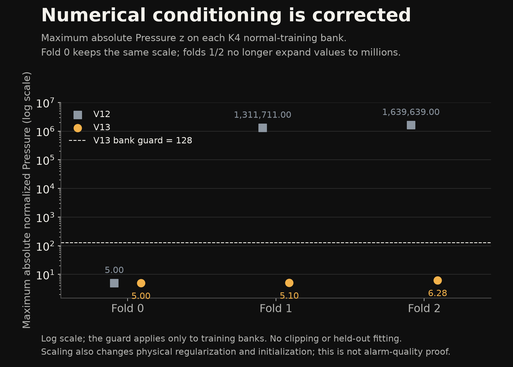

# SignalWatch: results, research history and limits

Evidence snapshot: **2026-10-27**. We have paused new training and threshold searches to document the completed experiments. **V5 remains the active model artifact.** V13 is the latest research experiment, not a deployed replacement. The false-alert quality goal remains open.

[Run the application](../README.md#run-locally) · [V1-V13 chronology](RESEARCH_LOG.md) · [Metric definitions](ML_EVALUATION.md) · [Download chart data](research/chart-data.json)

## The question and what we built

Can a learned detector find unusual behaviour in recorded water-circulation experiments while keeping false alerts and detection delay useful? We built a local workbench to inspect that trade-off against rolling median/MAD and persistence baselines.

The active V5 combines a trained histogram gradient-boosted known-state classifier with an ExtraTrees normal-behaviour predictor. Their feature vocabulary contains 120 classifier and 32 predictor columns. Both branches use current/past sensor observations, under the preloaded cadence/gap configuration. No LLM supplies the anomaly decisions. The model card records overlapping training subsets without counting them as additional independent examples.

The application includes a React/TypeScript event-review interface, a Python/FastAPI API, recorded replay, CSV mapping/import, local session persistence and export. The [screenshot guide](SCREENSHOTS.md) explains actual V5 desktop/mobile captures. They were taken on 2026-10-23 and do not depict newer research models.

## Active V5: development and retrospective evidence

| Evidence cohort | Detected events | False starts | Observed normal seconds | False starts / normal hour | Normal-alert seconds |
|---|---:|---:|---:|---:|---:|
| Grouped OOF development selection | 28/29 | 3 | 9,179 | 1.177 | 37 |
| Retrospective audit | 26/28 | 56 | 18,208 | 11.072 | 272 |

The 26/28 audit count meets the requested minimum of 25 events. The 11.072/h false-start rate exceeds the 2/h goal. Normal time in alert is 272/18,208 = **1.494%**. These are different measures: brief false alerts can produce many starts while occupying little time. Median delay over the 26 detected intervals is 18 seconds; the two missed intervals have no detection delay.

We used whole-recording folds to select on development predictions. We had already inspected the retrospective recordings during V1, so the later audit is not a new blind validation. Neither row estimates field reliability on other equipment.

Sources: [V5 development metrics](../artifacts/hybrid-development/report.json), [V5 retrospective metrics](../artifacts/hybrid/retrospective_audit.json), [active model card](MODEL_CARD.md).

## Detection improvements have a false-alert cost


This chart uses V4/V5/V7 on the same 28-segment corpus and eligible normal exposure. V5 gains four detections over V4 while adding thirteen false starts. V7 reduces development false burden while losing one event, then regresses on the retrospective corpus; we rejected activation.

| Version | Retrospective detections | False starts | Observed normal seconds | False starts / hour | Normal-alert seconds |
|---|---:|---:|---:|---:|---:|
| V1, corrected onset metric | 5/28 | 33 | 17,311 | 6.863 | 16,901 |
| V2, normal-only innovation | 11/28 | 43 | 18,208 | 8.502 | 177 |
| V3, first supervised classifier | 23/28 | 40 | 18,208 | 7.909 | 270 |
| V4, weighted classifier | 22/28 | 43 | 18,208 | 8.502 | 245 |
| V5, complementary fusion, active | 26/28 | 56 | 18,208 | 11.072 | 272 |
| V7, calibrated ensemble, rejected | 23/28 | 81 | 18,208 | 16.015 | 386 |

V1 uses longer warm-up and less eligible exposure; only 25/28 intervals contain any V1 score, versus 28/28 later. Its corrected result is 5/28. The original overlap-based 25/28 credited pre-existing alerts and is retained only as a superseded metric. Do not interpret the chronology as an unbiased model leaderboard.

The [CSV](research/retrospective-results.csv) and [chart JSON](research/chart-data.json) retain full precision, source paths and JSON pointers. We show unscored versions in the chronology as unscored, not as zero detections.

## Version evolution

| Stage | Change | Finding and decision |
|---|---|---|
| V1 | Absolute normal-behaviour prediction; corrected event metric | Normal operating levels differ from training. Corrected recall is 5/28; a continuous alert is not repeated detection. |
| V2-V4 | Normal-relative innovation, supervised classification, recording-balanced weights | Different model families miss different events. Weighting improves development selection without the same retrospective gain. |
| V5 | Combine classifier and normal-only predictor | 26/28 retrospective detections; retained as active artifact, with false-alert control unresolved. |
| V6 | Elapsed alarm confirmation | Lower false counts lose short events. No positive wait qualifies. |
| V7 | Recording-disjoint calibrated ensemble | 27/29 development, then 23/28 retrospective with 81 false starts. Reject activation. |
| V8 | Fixed component/calibration study | Better probability losses do not yield a qualifying alarm system. No new arm passes. |
| V9 | One fixed branch-selective policy and a separate-record check | Partial burden reduction costs one short development event. Both V5/V9 miss one of four separate-record interventions. Research candidate only. |
| V10-V11 | Causal trend features, difficult-normal weighting and alternative learners | No candidate retains both gradual intervals while meeting all recall/burden conditions. |
| V12 | Learn normal-regime mixtures before the trend classifier | No winner among 306 operating points. Pressure scaling also reveals a numerical-conditioning defect. |
| V13 | Correct training-bank Pressure scaling | Numerical audits pass. K4 burden improves with worse linear delay; K2 worsens. No quality winner or activation. |

Version numbers include changes to models, alarm policies and evaluation studies. They do not mean thirteen independently validated production models. The [complete V1-V13 chronology](RESEARCH_LOG.md) links each method, frozen protocol and retained result; the [related-work comparison](RELATED_WORK_COMPARISON.md) separates external literature from what we implemented.

## Latest result: Pressure correction and gradual defects

We replaced only the normal-bank Pressure scale with max(IQR, population std, 1e-6), using training-bank observations. Other V12 rules stay fixed. We ran nine mixture and nine classifier fits, followed by the predeclared 306-point screen. None met the joint requirements, so we did no final refit, old-audit/teaser inference or replacement activation.



| Mixture arm | False starts, V12 to V13 | Normal-alert seconds, V12 to V13 | Linear delay, V12 to V13 | Exponential delay, V12 to V13 |
|---|---:|---:|---:|---:|
| K1 | 5 to 5 | 37 to 37 | 46 to 46 s | 7 to 7 s |
| K2 | 6 to 17 | 37 to 75 | 46 to 26 s | 7 to 7 s |
| K4 | 40 to 21 | 176 to 111 | 3 to 46 s | 7 to 6 s |

These descriptive frontiers all retain **27/29 events and both source-described gradual intervals**, over the same 9,179 observed normal seconds. K denotes mixture components. We choose each arm/version's frontier under the same predeclared rule; its numeric cutoff can differ. In K2, other-9 probabilities stay identical but the lower shared cutoff produces more false starts. This is not a matched-cutoff causal estimate of the scaling change.

K4 improves burden but delays the linear interval by another 43 seconds. No waiting rule was added. At the lower-burden K1/K2 points, 26/29 events, one false start and 28 normal-alert seconds still miss the linear interval. Reporting only the best false count would hide that failure.

The quality screen requires >=26/29, fewer than three false starts, <=2/h, <=37 normal-alert seconds and retention of both gradual intervals. No V13 point passes. This comparison does not establish general gradual-fault performance from two intervals.

[Full paired result](ML_V13_PRESSURE_SCALING_RESEARCH.md) · [Frozen report](../artifacts/pressure-scaled-development/report.json) · [Frontier CSV](research/v13-paired-frontiers.csv)

## Numerical success is separate from alarm quality



Maximum absolute normalized Pressure falls from about 1.64 million to 6.28 on the training banks. All 279 saved numerical audits pass. Centered and expanded fixed-parameter NLL formulas differ by at most 3.64e-12, under the declared 1e-7 tolerance. The unchanged fold 0 reproduces V12 scores exactly.

Scaling also changes physical covariance regularization and initialization geometry. We cannot attribute all quality changes to cancellation alone. Numerical agreement is neither classification accuracy nor proof of generalization. The [bank CSV](research/pressure-training-banks.csv) records each old/new scale and the old-maximum derivation; the [V13 report](ML_V13_PRESSURE_SCALING_RESEARCH.md) retains the full caveats.

## Definitions and limitations

- An event is an annotation interval split at timestamp gaps. A hit needs a new alert onset inside it; an earlier continuous alert does not count. Segments are not independent machines or failures.
- False starts begin on labelled-normal rows. Normal-alert seconds also include alert tails after a true onset. Neither sensor deviation nor label disagreement proves a physical danger or an annotation mistake.
- Development selection has repeatedly reused the same records. All benchmark recordings represented here come from one physical testbed. The four-intervention teaser is a limited same-testbed check with different annotation/background assumptions; we already inspected it.
- Replay uses a complete file's preloaded cadence/gap configuration. Prefix checks do not validate initialization from an unknown raw stream.
- Classifier/predictor scores and contributing sensors do not establish a field-failure probability or a physical root cause. No safety limits, operator commands or independent incident adjudication were available.
- We have no field-equipment, new-machine or physical-phone validation. Existing browser-emulated mobile checks do not establish screen-reader support. We have not run a common-protocol external benchmark or claimed SOTA performance.
- Software checks and an implemented local workbench do not close the unresolved false-alert requirement. We have paused further training, not declared that quality goal complete.

The [data card](DATA_CARD.md), [model card](MODEL_CARD.md) and [requirements register](REQUIREMENTS.md) preserve the boundaries in detail.

## Verify this snapshot without training

From the project root, with the application environment installed:

```powershell
.\.venv\Scripts\python.exe scripts/build_research_summary.py --check
```

This check reads saved reports, checks rate/denominator consistency and verifies chart data, CSVs, generator identity and image hashes. It imports no model or plotting library and starts no fitting, inference or threshold search. [Figure reproduction and source index](research/README.md) describe the separate authoring environment.

The last backend suite before V13 passed 192 tests with seven existing warnings. We do not present that as a fresh test run for this documentation task. [Verification history](VERIFICATION.md) and [packaging evidence](evidence/research-packaging-check-2026-10-27.json) distinguish the two.

## Research status and resumption

We have paused new ML training and cutoff tuning at the user's request. The local workbench and active V5 artifact remain available. The existing manual training endpoint still reproduces the selected release when a user explicitly starts it; we did not remove that feature or invoke it for this snapshot.

Resuming research calls for a separately agreed hypothesis and frozen evaluation. New independent normal regimes/gradual cases would address a different evidence gap from another sweep on these same records. R17/R20 remain open; there is no promised next-model improvement.
