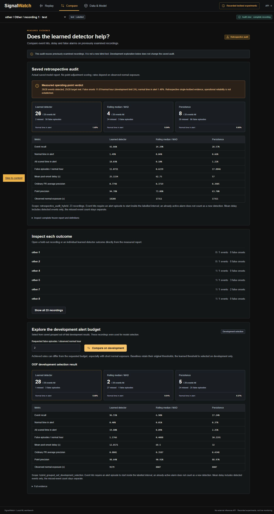
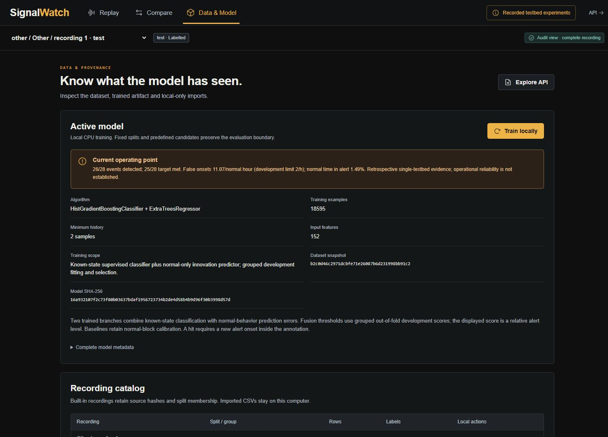
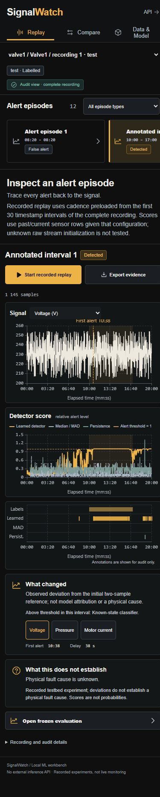
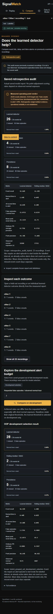
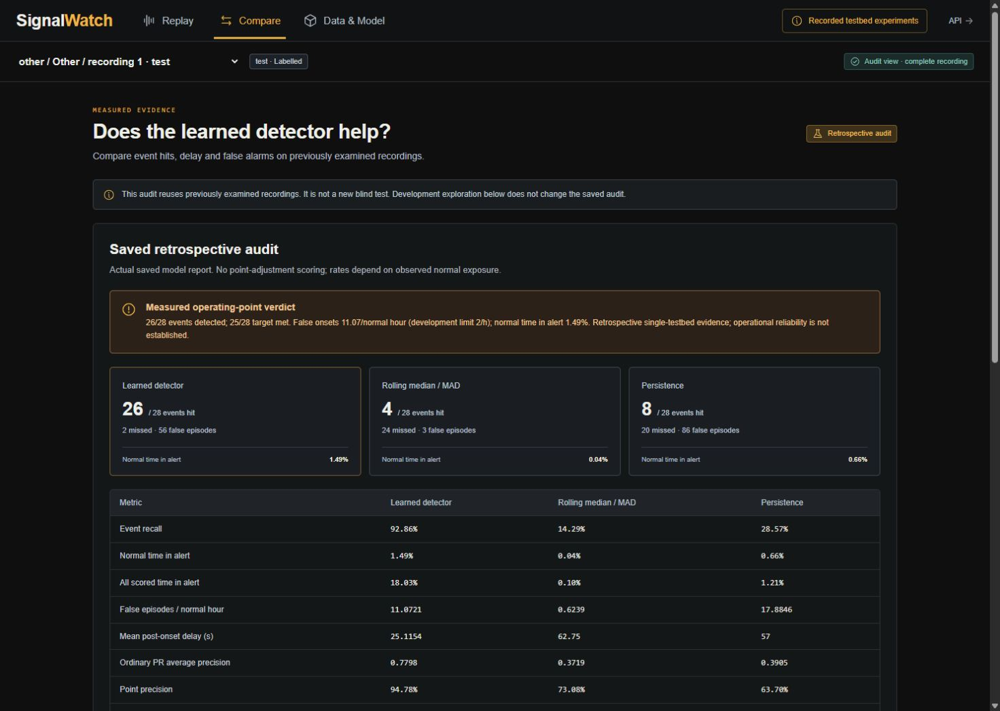
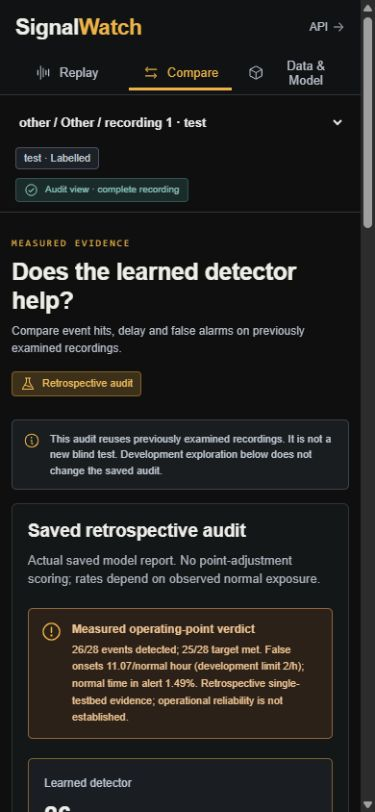
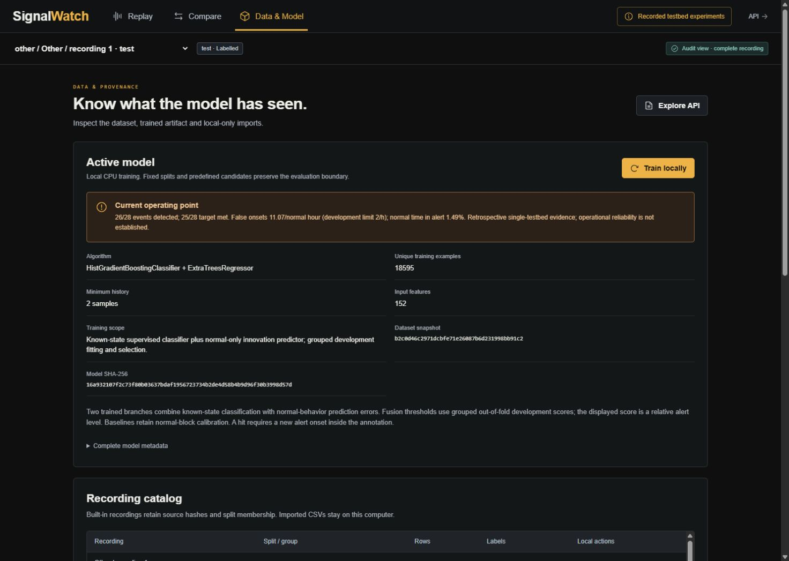
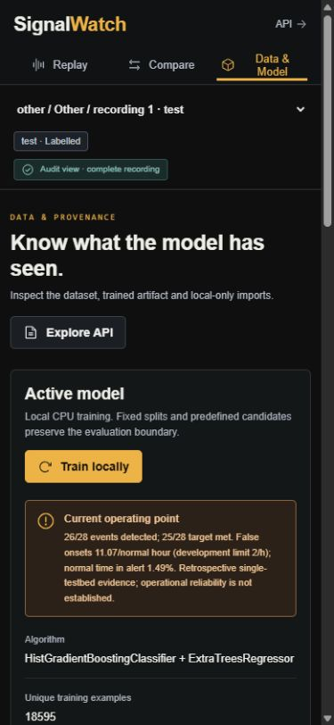

# Current interface guide

These V5 captures show actual local SKAB data and saved results on 2026-10-23. The approved generated concept remains an illustrative layout reference. Older files with earlier version suffixes document their respective releases and are retained as history.

## Event review

Valve1 recording 1 contains an annotated interval from 10:00 to 17:00. The selected interval is detected at 10:38, a measured 38-second delay. Branch text shows the known-state classifier exceeded its threshold inside that interval. The queue also retains false alerts. Sensor buttons show observed deviations from the initial reference; they do not explain classifier attribution or a physical cause. Learned history is two samples; baselines use thirty.

## Retrospective comparison

The visible verdict states 26/28, two misses and 56 false starts. Normal time in alert is 1.49%. The requested 25/28 is met; the 2/h limit fails at 11.072/h. Baseline columns retain their original scores. The page identifies retrospective evidence and keeps development threshold exploration separate.

## Model provenance

Data & Model identifies both fitted branches, 18,595 unique training examples and 152 branch features (120 classifier + 32 predictor). The normal-only predictor uses an overlapping 13,891-example subset. Complete metadata includes the current model hash, original audited model hash and frozen plan. The local training action repeats the selected experiment in staging before publication.

## Mobile

At 390 x 844, navigation and controls stack above the content. Document width stays within the viewport; comparison tables scroll inside their container. Browser emulation does not establish physical-phone or screen-reader support.

## V5 retained after rejected experiments

These additional captures show the running application after the V6/V7 experiments and server restart. V5 remains active; they do not depict a V7 release.

The actual saved report still shows 26/28 and 56 false starts. The false-onset limit remains unmet. The rejected V7 result is preserved separately in ML_V7_RESEARCH.md and its retrospective audit, rather than presented as the active model.

Data & Model labels 18,595 as unique training examples; overlapping predictor examples are not added. At 390px and 1487px, Compare and Data & Model remain within document width. Browser error logs were empty. Physical phone and inactive experimental V6/V7 visual states were not tested.
